# A variable-pitch propeller on a home-built thrust bench

**Aerospace Propulsion (AS343AI), project-based lab** · RV College of Engineering, Bengaluru · 4th semester, 2024–25 · guided by Dr. Supreeth R

A fixed propeller is a compromise: its blade angle suits one speed and is wrong for the rest. A
variable-pitch propeller turns its blades in the hub so the angle can follow the flight. In our
fourth semester, five of us set out to build one: a hub that turns two blades with a servo, a
wooden test stand that measures the thrust, and the Arduino code that runs it all.

This was a product, not a research project, and the most hands-on thing we had done. We designed
the blades in OpenProp, drew the hub in SolidWorks, printed it, bought parts on SP Road, built the
stand from wood and aluminium brackets, and spent weeks of late nights at Shanthosh's
home getting four Arduinos to agree with each other. Along the way we ran our first ever CFD. Looking
back, most of it is basic, and the CFD is not something we would stand behind today. At the time it
was a lot to us, and it was the most fun we have had in college.

<p align="center">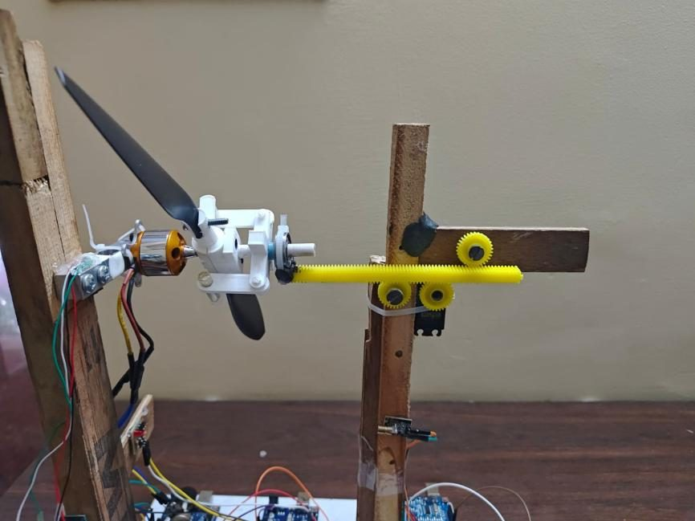<br>
<sub>The bench. The motor and the printed hub sit on the left post, with two blades in the hub; on the right
post the servo turns a pinion, which slides the yellow rack into the hub and turns the blades.</sub></p>

| | |
|---|---|
| **Propeller** | two blades in a 3D-printed hub; an MG995 servo sets the pitch through a rack, a sliding controller and two links |
| **Bench** | a brushless motor on a 5 kg load cell, a laser tachometer across the blade path, and four Arduino Unos |
| **Design** | blade sections from OpenProp (MATLAB), the hub in SolidWorks, printed in PLA on a Creality Ender-3 Pro |
| **CFD** | SolidWorks Flow Simulation at 3000 RPM and sixteen pitch settings: our first CFD, never validated |
| **Measured** | 102 g of thrust at a pitch of 2°, rising to 202 g at 15°, at about 3000 RPM |
| **Team** | five students, May to July 2025 |

---

## What we built

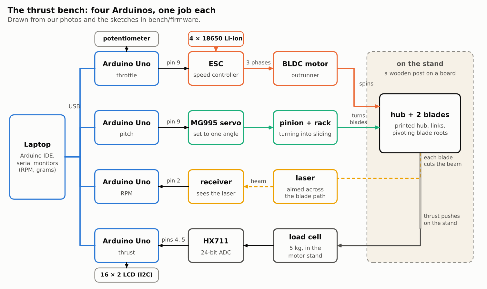

Each Arduino has one job. One turns a potentiometer into the pulses the motor's speed controller
expects, one holds the servo at the pitch we ask for, one times the breaks in a laser beam that the
blades cut, and one reads the load cell under the motor. None of them talks to another; the laptop shows
the RPM and the thrust on the serial monitor. One job per board kept every sketch small, and getting
them all running at once still took us a long time. The parts, the six sketches and their quirks are
in [bench/](bench/README.md).

## How the blades change pitch

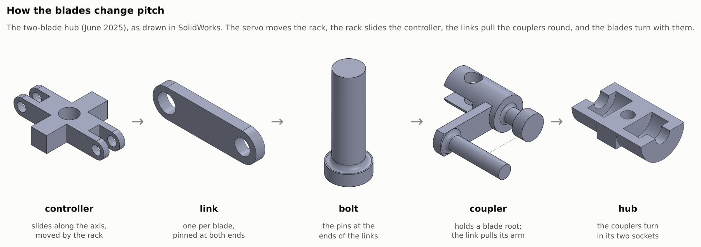

The servo turns a pinion, the pinion slides a rack, and the rack pushes a cross-shaped controller
along the propeller's axis. A link from each end of the controller pulls on an arm of a coupler, and
the coupler, which holds a blade root, turns in its socket in the hub. Push the rack in and both
blades twist together:

<p align="center">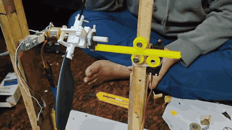<br>
<sub>The servo moving the rack and the blades turning with it, on the bench.</sub></p>

The hub went through two versions, three blades and then two; both are in [cad/](cad/README.md),
with the SolidWorks files.

## How it came together

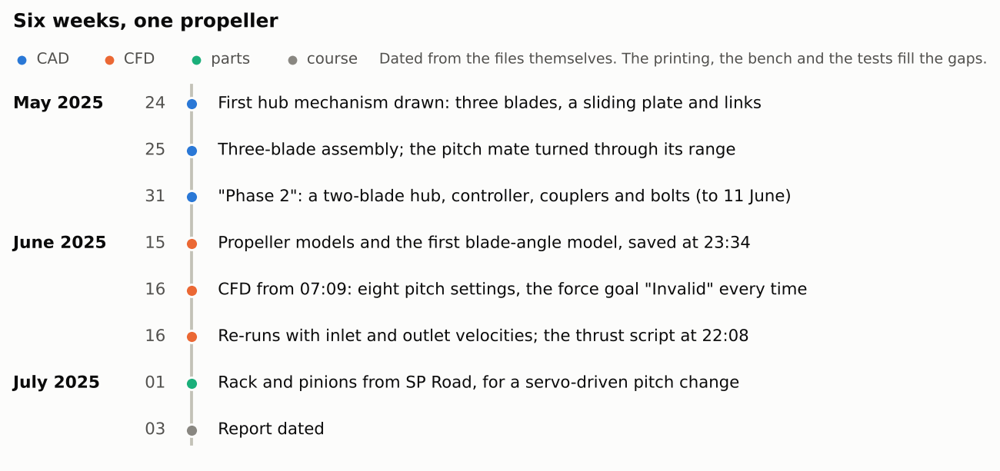

### May: a blade from an equation, and a hub with three arms

We started from the blade. OpenProp, a free MATLAB program, takes the thrust you want, the speed, the
RPM and the diameter, and works out the chord and pitch of every section along the blade. Our first
design asked for 20 N at 15 m/s from a three-blade, 0.42 m propeller at 6000 RPM
([design/](design/README.md)). The sections went into SolidWorks as curves and became a blade, and on
24–25 May the first hub took shape around it: three sockets, a plate sliding on the shaft, and a link
to each blade.

<p align="center">
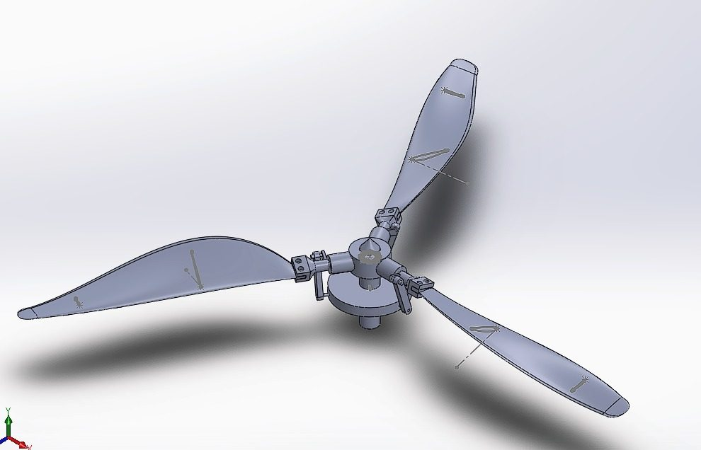 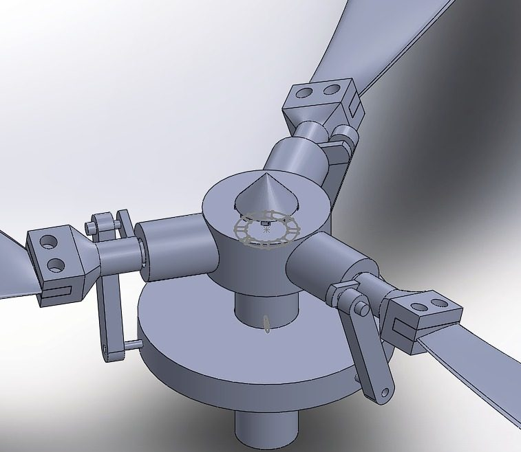<br>
<sub>The three-blade version, 25 May 2025: the whole propeller, and the hub with its couplers and links.</sub></p>

A week later, on 31 May, the "phase 2" hub had two blades instead of three. That is the one we
built.

<p align="center">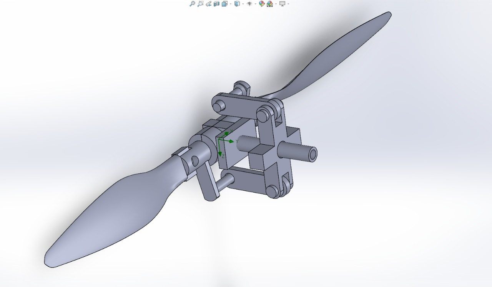<br>
<sub>The two-blade hub in SolidWorks (June 2025), with the cross-shaped controller behind the hub.</sub></p>

### June: the CFD night

On the evening of 15 June we brought propeller models into SolidWorks, saved the first blade-angle
model at 23:34, and were running Flow Simulation at 07:09 the next morning: eight pitch settings
by 10 am, a second round with different measurements by half past two, and a Python script that
turned the results into thrust at 22:08 that night. It was the first time any of us had touched CFD.
What came out, and why we no longer trust it, is [below](#our-first-cfd) and in [cfd/](cfd/README.md).

### Printing

The hub, the controller, the couplers and the pins were printed on a Creality Ender-3 Pro, sliced in
Cura 5.10 at 0.2 mm layers and 100 % infill: two plates of about 2.5 and 2 hours. The G-code is in
[print/](print/README.md). The blades were printed too, lying flat on supports.

<p align="center">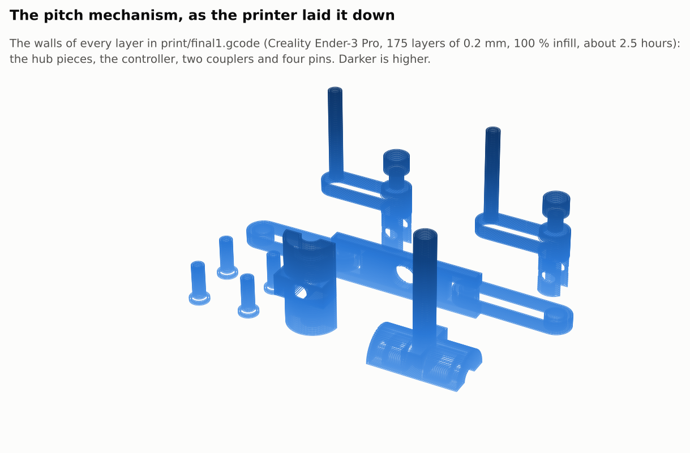</p>

<p align="center">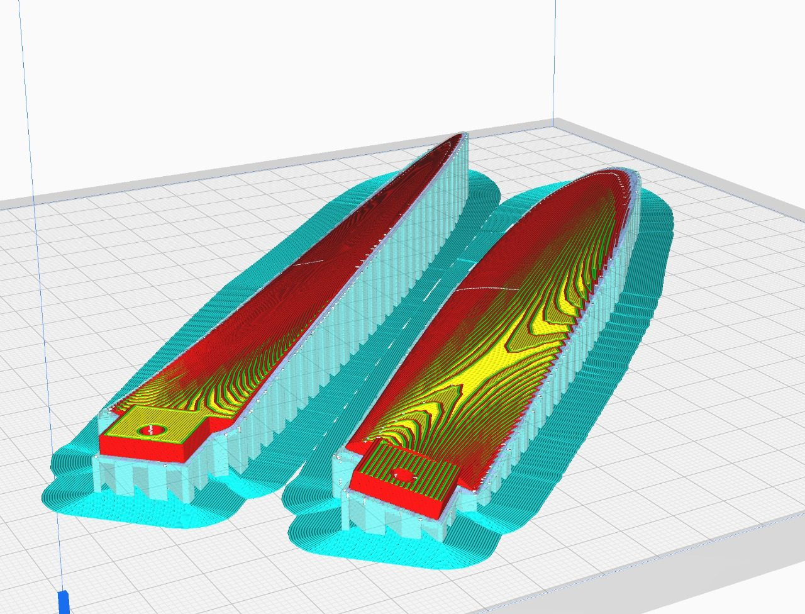<br>
<sub>The two blades in Cura, on their supports.</sub></p>

### July: racks, a servo and four Arduinos

The report describes setting the pitch by hand with alignment pins. We wanted the servo to do it,
so on 1 July we were at SP Road for a rack and pinions:

<p align="center">
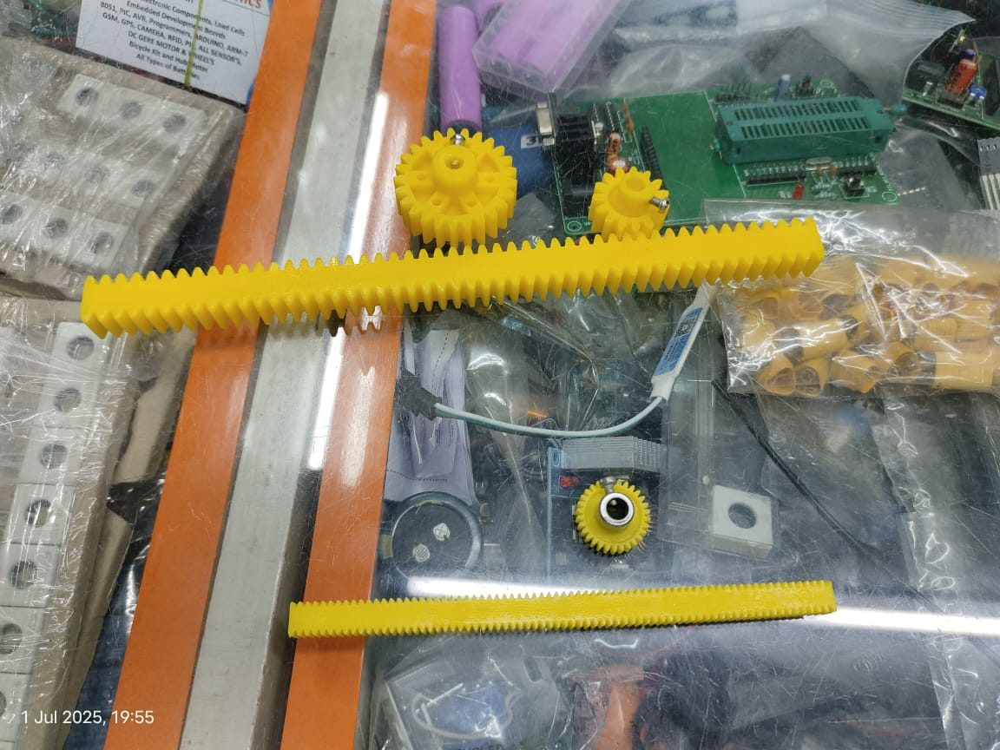 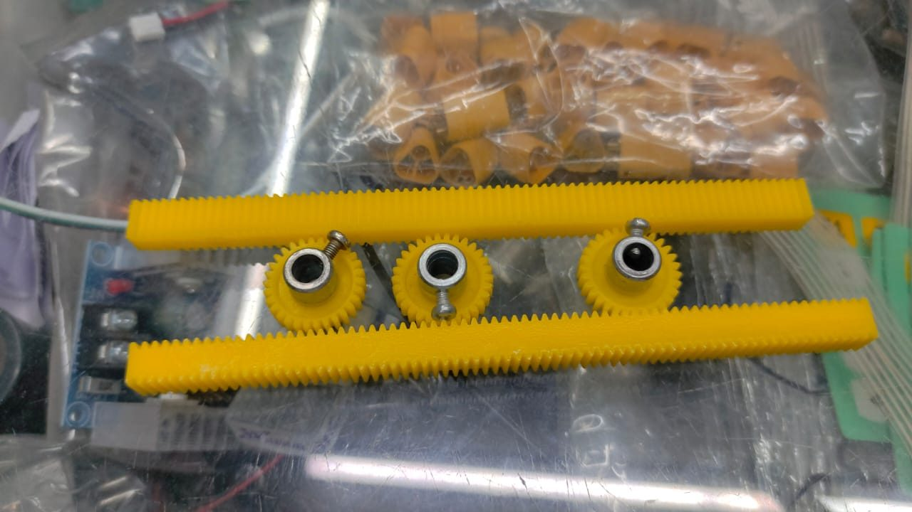 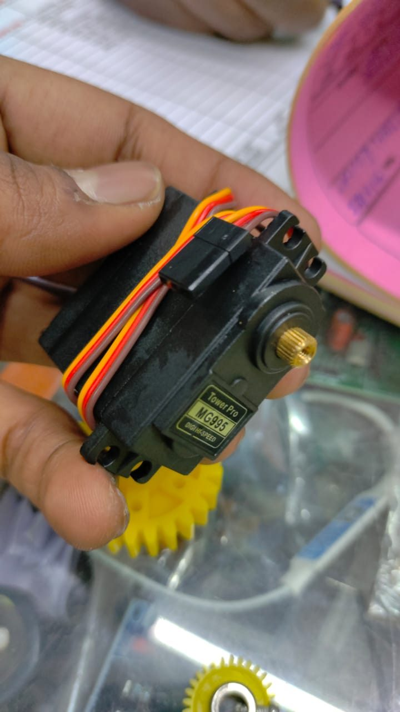<br>
<sub>1 July 2025: racks and pinions on a shop counter, and the servo with a pinion on it.</sub></p>

Then came the bench itself, and the Arduino code, which took longer than everything else. The last
sketches were saved at 00:22 on 3 July, the date on our report.

<p align="center">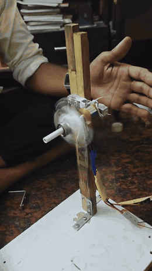<br>
<sub>Spinning on the bench. A longer clip, without its sound, is <a href="media/bench-run.mp4">here</a>.</sub></p>

## What we measured

At about 3000 RPM, with the pitch set to four angles:

| Pitch | Thrust | |
|---|---|---|
| 2° | 102 g | 1.00 N |
| 4° | 130 g | 1.28 N |
| 10° | 172 g | 1.69 N |
| 15° | 202 g | 1.98 N |

More pitch, more thrust, as it should be. These four numbers, from Section 2.8 of our report, are
all that survives; we never logged the readings
([`bench/measured_thrust.csv`](bench/measured_thrust.csv)).

## Our first CFD

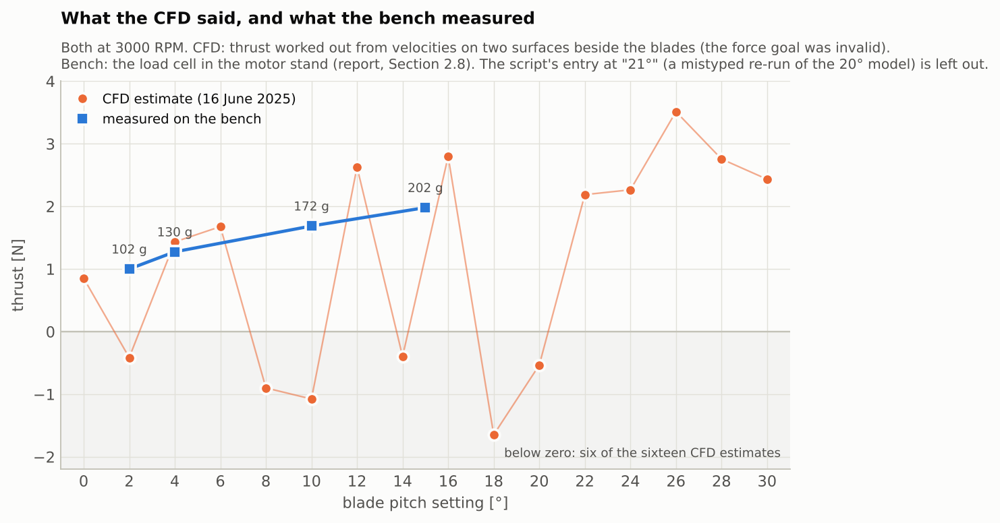

Uday ran all the SolidWorks simulations: the propeller in a rotating region at 3000 RPM, at sixteen
pitch settings from 0° to 30°. The force goal that should have given the thrust directly came back
"Invalid" every time, so we worked out a thrust afterwards from the air speeds on two surfaces either
side of the blades, with momentum theory. The result jumps from +2.6 N to −0.4 N between neighbouring
angles, and six of the sixteen values are negative, which a propeller spinning in still air at a
positive pitch cannot be. Nothing was ever
compared with the bench, a mesh study or a published propeller. [cfd/](cfd/README.md) keeps the
setup and the numbers, and explains, as far as we understand it now, why they came out this way.

<p align="center">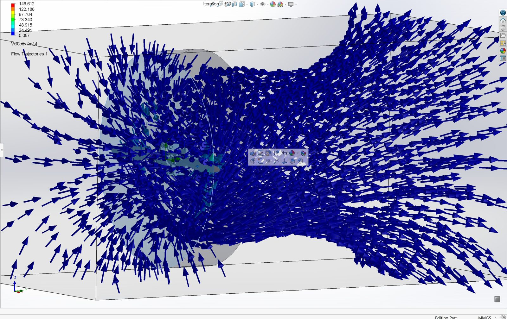<br>
<sub>Flow trajectories at a pitch of 20°, 16 June 2025.</sub></p>

## What we learned

* **Check that the solver is giving you the quantity you want before you run sixteen cases.** One
  invalid force goal, noticed on the first run, would have saved the whole CFD.
* **Momentum theory needs the right velocities.** The air speed far upstream and far down the
  slipstream, not the swirling flow on two surfaces right beside the blades.
* **Design for the test you will run.** OpenProp designs a propeller for a forward speed; our bench
  measured static thrust, with no air moving past at all.
* **Log the data.** A few lines of Python reading the serial port into a file would have left us more
  than four numbers.
* **Calibrate in one place.** The load-cell sketch and the LCD sketch use different calibration
  factors; the serial monitor and the LCD only agree by accident.
* **Know your signal ranges.** The Servo library sends 544–2400 µs pulses; an ESC listens between
  about 1000 and 2000 µs, so the ends of the potentiometer did nothing.
* **Measure what the servo angle means.** The code sets a servo angle; which blade pitch that gives
  was never written down.
* **Write the report from the data.** Ours has a smooth simulated-versus-measured table that no file
  supports; it is listed with the other corrections in [report/](report/README.md).

## Run it yourself

* **The bench:** install the Arduino IDE, add **HX711_ADC** (Olav Kallhovd) and **LiquidCrystal I2C**
  from the Library Manager, and upload each sketch in [`bench/firmware/`](bench/firmware) to its own
  Arduino Uno; the pins are in [bench/](bench/README.md). All six compile; we checked them with avr-gcc
  and the Arduino AVR core ([`tools/check_sketch.sh`](tools/check_sketch.sh)).
* **The hub:** open the SolidWorks files in [`cad/`](cad/README.md), or print the G-code in
  [`print/`](print/README.md) on an Ender-3 Pro.
* **The figures:** `python3 tools/make_figures.py` redraws everything in `figures/` from the CSV
  files, the G-code and the CAD previews (it needs matplotlib, numpy and Pillow).

## What's in this repository

```
bench/       the thrust bench: parts, wiring, the six Arduino sketches, the measured thrust
cad/         both hubs in SolidWorks, with the previews stored inside the files
design/      the OpenProp blade designs
cfd/         the Flow Simulation setup, the script and its numbers, and why they jump
print/       the two G-code plates for the Ender-3 Pro
media/       photos, GIFs and a short video (no sound)
figures/     the diagrams in these pages, drawn by tools/make_figures.py
report/      our report as submitted, with corrections
tools/       make_figures.py, check_sketch.sh, sw_preview.py (SolidWorks previews)
```

## The report

[`report/`](report/README.md) has our report, *Design and Prototype Development of Variable Pitch
Propeller*, dated 3 July 2025, exactly as we submitted it. Next to it is a list of what it gets
wrong: a results table and a headline thrust that no measurement supports, a tachometer that is
not the one we built, and a few more.

---

## Team

**Akula Uday Kiran**, **Rutuj Dugad Manoj**, **Shanthosh K V**, **Tejas L** and **Yashwanth R**,
Department of Aerospace Engineering, RV College of Engineering, Bengaluru. Guided by
**Dr. Supreeth R**, Associate Professor and Head of the Department.

We did almost everything together; the SolidWorks simulations were Uday's. Thank you to Shanthosh,
for weeks of late nights at his home, and to the shops on SP Road, which saw a lot of us.

This repository was put together in November 2026 from our project files, photos and videos; the
figures, the CFD table and these notes were written then.

## License

The code (`bench/firmware`, `cfd/Final_graph_code.py`, `tools`) is MIT-licensed ([LICENSE](LICENSE)).
Two sketches started from the examples of the HX711_ADC library (© 2017 Olav Kallhovd, MIT) and say
so at the top. The CAD, the G-code, the photos, the videos and the report are the team's own work.
