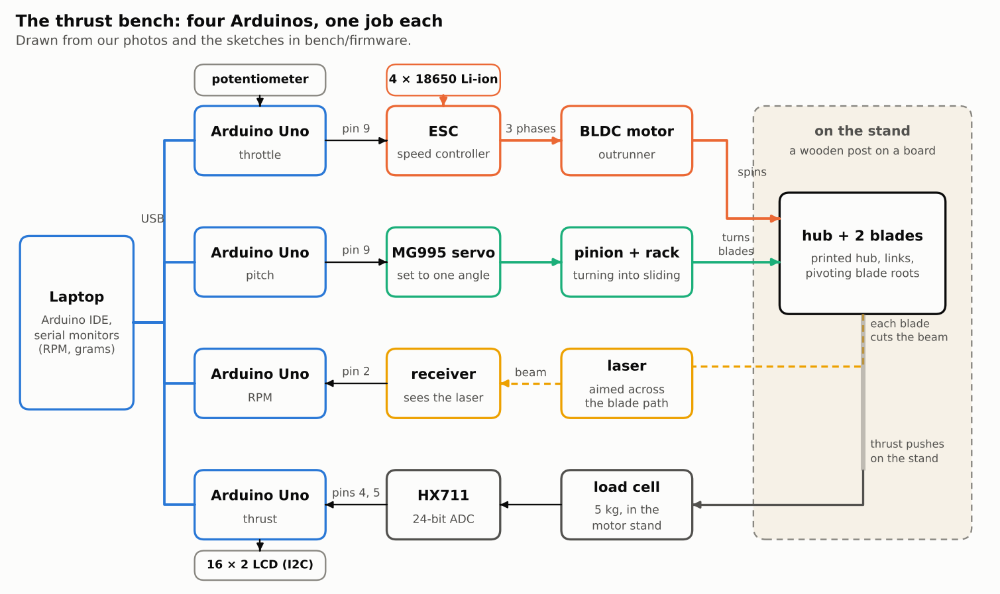
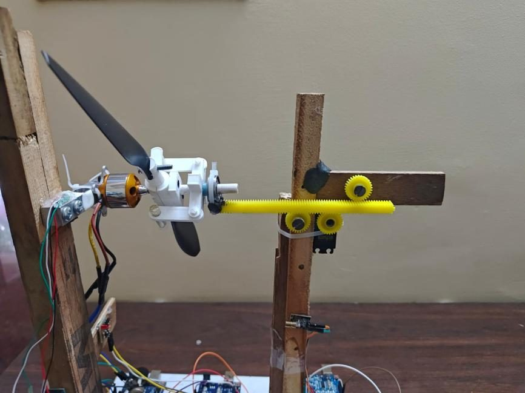
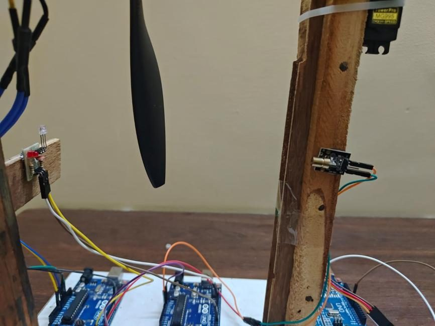
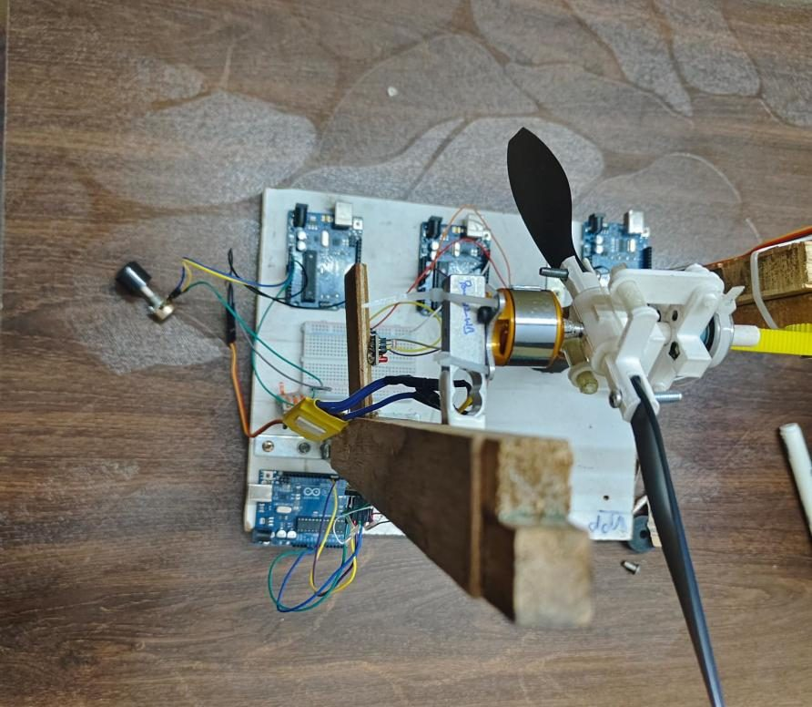

# The thrust bench

*[← back to the project](../README.md)*

The bench is a wooden post on a board, with the motor and the propeller at the top. Four Arduino
Unos each do one job: one is the throttle, one sets the pitch, one counts revolutions and one
reads the thrust. Getting these four to work, and then to work at the same time, took us a long
time to figure out.

  
Left: the motor and the hub on the left post; the servo turns a pinion on the right post, which slides the
yellow rack into the hub. Right: the tachometer, a laser on one post and its receiver on the other, with the
blades passing between them (the servo is at the top right).

## Parts

| Job | Parts |
|---|---|
| Spin | an outrunner brushless motor, an ESC, a pack of four 18650 Li-ion cells |
| Throttle | a potentiometer read by Arduino 1, which sends the ESC servo-style pulses |
| Pitch | an MG995 servo driven by Arduino 2, a plastic pinion and rack, and the printed linkage in the hub |
| RPM | a laser module and a receiver across the blade path, read by Arduino 3 |
| Thrust | a 5 kg bar load cell in the stand, an HX711 amplifier, Arduino 4, and a 16 × 2 LCD on I2C |
| Frame | wooden posts on a white board, aluminium brackets |

The rack and the pinions came from SP Road on 1 July 2025 ([photo](../media/sp-road-rack-and-pinions-2025-07-01.jpg)).

## The sketches

Each sketch sits in a folder of its own name, which is how the Arduino IDE expects it. They are as we
left them; the only additions are the credit lines at the top of the three that started from
library examples.

| Sketch | Arduino | What it does | Pins |
|---|---|---|---|
| [`BLDC_Pot_Control`](firmware/BLDC_Pot_Control/BLDC_Pot_Control.ino) | 1, throttle | reads the potentiometer and sends the ESC the matching pulse, like a servo | pot on A0, ESC signal on 9 |
| [`pitchhhh`](firmware/pitchhhh/pitchhhh.ino) | 2, pitch | moves the servo to one angle at power-up (`int angle = 120;`) | servo signal on 9 |
| [`FINAL_TACHO`](firmware/FINAL_TACHO/FINAL_TACHO.ino) | 3, RPM | times the gaps between beam breaks with an interrupt, two per revolution, and prints the RPM | receiver on 2 |
| [`calibration`](firmware/calibration/calibration.ino) | 4, thrust | the HX711_ADC library's calibration example: tare, put on a known mass, type its mass, save the factor to EEPROM | HX711 DOUT on 4, SCK on 5 |
| [`loadcell`](firmware/loadcell/loadcell.ino) | 4, thrust | prints `Weight(g): …` to the serial monitor, using the factor saved in EEPROM | HX711 on 4, 5 |
| [`calibrated`](firmware/calibrated/calibrated.ino) | 4, thrust | shows the reading on the LCD instead, with a fixed factor | HX711 on 4, 5; LCD on A4, A5 (I2C, address 0x27) |

To use them: install **HX711_ADC** (Olav Kallhovd) and **LiquidCrystal I2C** from the Library Manager
(Servo comes with the IDE), choose *Arduino Uno*, and upload. All six compile for an Uno; we checked
them with avr-gcc and the Arduino AVR core ([`tools/check_sketch.sh`](../tools/check_sketch.sh)).

### Things worth knowing

* **Two calibration factors.** `calibrated` hard-codes a factor of 1500. `loadcell` sets 409.68 and
  then, on the next line, overwrites it with whatever `calibration` saved in EEPROM. The serial
  monitor and the LCD only agree if the saved factor was 1500.
* **`loadcell` makes an LCD object and never starts it.** The LCD is `calibrated`'s job.
* **The tachometer talks at 2,000,000 baud.** Set the serial monitor to match. It averages a few
  readings and then waits 1.5 s between prints.
* **The throttle pulse range is wider than the ESC's.** The Servo library sends 544–2400 µs for
  0–180°, while ESCs work between about 1000 and 2000 µs, so the two ends of the potentiometer's
  travel do nothing. (The sketch reads A0, although a comment says A1.)
* **The pitch is set one angle at a time.** Change the number in `pitchhhh`, upload, and the blades
  move. Which servo angle gives which blade pitch is not in the code; the report mentions a digital
  protractor for checking the blade angle.

## What we measured

At about 3000 RPM, with the pitch set to four angles (report, Section 2.8):

| Pitch | Thrust | |
|---|---|---|
| 2° | 102 g | 1.00 N |
| 4° | 130 g | 1.28 N |
| 10° | 172 g | 1.69 N |
| 15° | 202 g | 1.98 N |

The same numbers are in [`measured_thrust.csv`](measured_thrust.csv). In one of our videos the serial
monitor scrolls through readings of −126, −135 and −144 g; the sign only says which way the load
cell was mounted. No logs survive, so these four points are what is left.

 
From above: the four Arduino Unos on the board, the motor and the hub, and the blades.

