# CAD: two hubs in SolidWorks

*[← back to the project](../README.md)*

The hub went through two versions in three weeks. Both are SolidWorks 2024 files: open them with
SolidWorks 2024 or later, or with the free eDrawings viewer. The pictures below are the previews
stored inside the files themselves, pulled out with [`tools/sw_preview.py`](../tools/sw_preview.py).

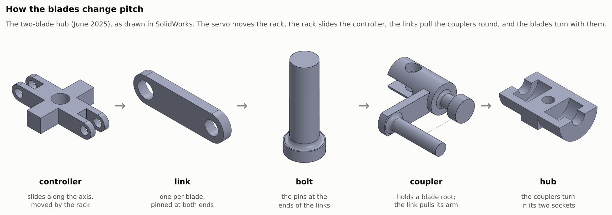

## Version 1: three blades (24–25 May 2025)

A round hub with three blade sockets, a plate below it that slides along the shaft, and a link from
the plate to each blade root. The blade was lofted from the OpenProp sections.

<table>
<tr>
<td align="center">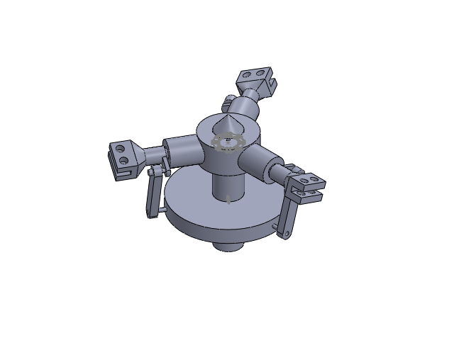 <code>TOTAL HUB.SLDASM</code> the assembly</td>
<td align="center">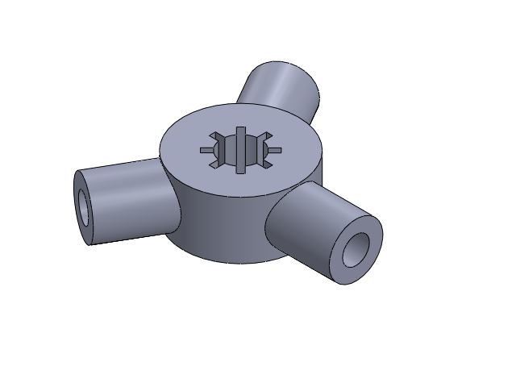 <code>hub</code> three sockets</td>
<td align="center">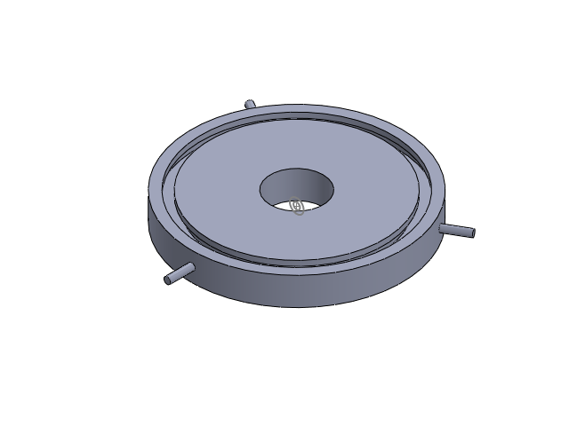 <code>pitch controller</code> the sliding plate</td>
<td align="center">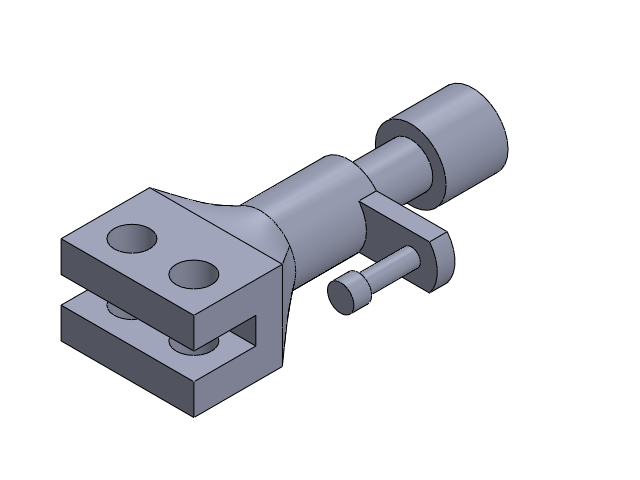 <code>coupler</code> holds a blade root</td>
</tr>
<tr>
<td align="center">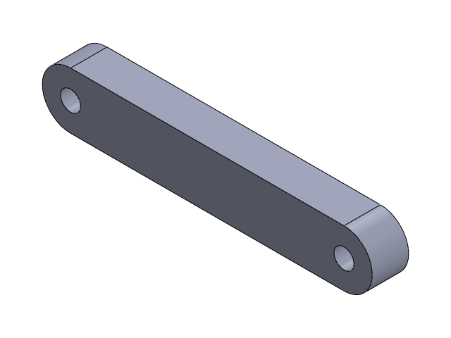 <code>string</code> the link</td>
<td align="center">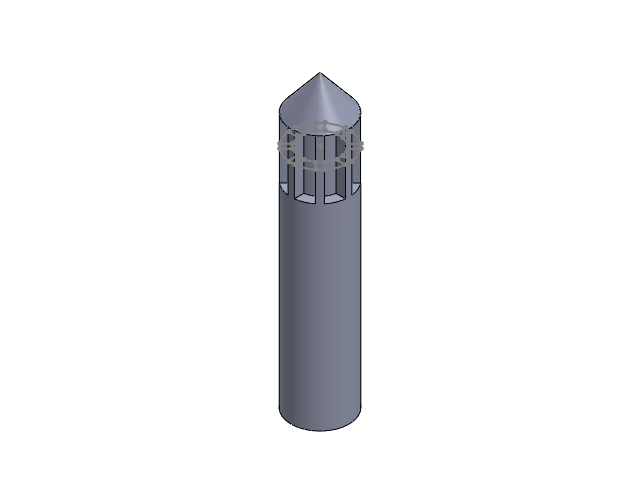 <code>shaft</code></td>
<td align="center">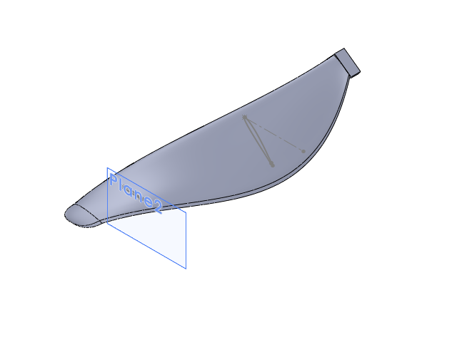 <code>trial 1 blade</code> lofted from OpenProp</td>
<td align="center">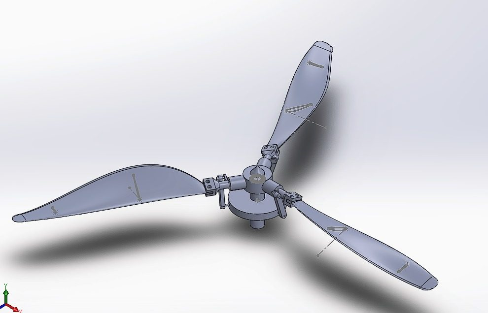 the whole propeller</td>
</tr>
</table>

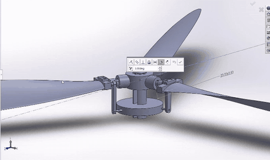 
25 May 2025: turning the pitch mate of the three-blade assembly through its range in SolidWorks.

## Version 2: two blades (31 May – 11 June 2025)

Two blades instead of three, a block-shaped hub, and a cross-shaped controller with a link to each
blade. This is the version we printed and put on the bench.

<table>
<tr>
<td align="center">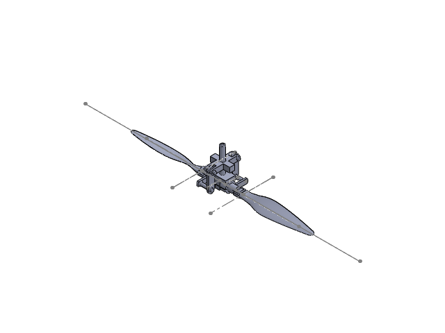 <code>Assem1.SLDASM</code> the assembly</td>
<td align="center">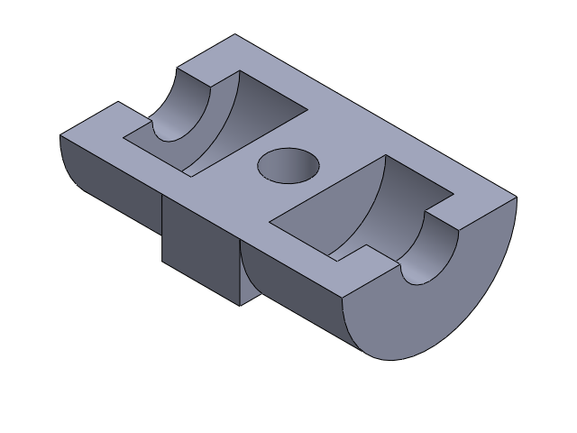 <code>hub</code> two sockets</td>
<td align="center">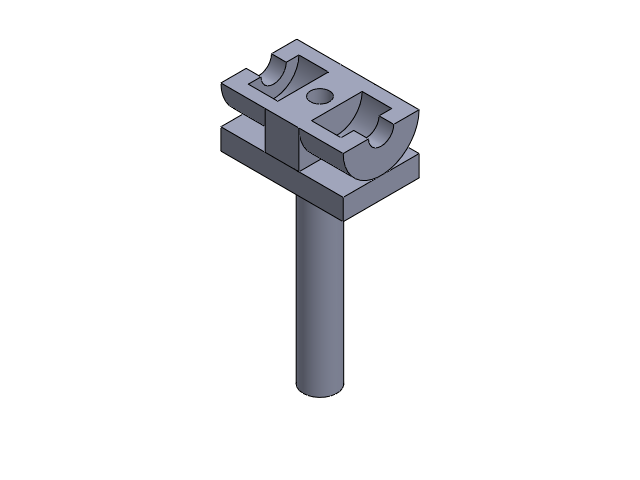 <code>hub1</code></td>
<td align="center">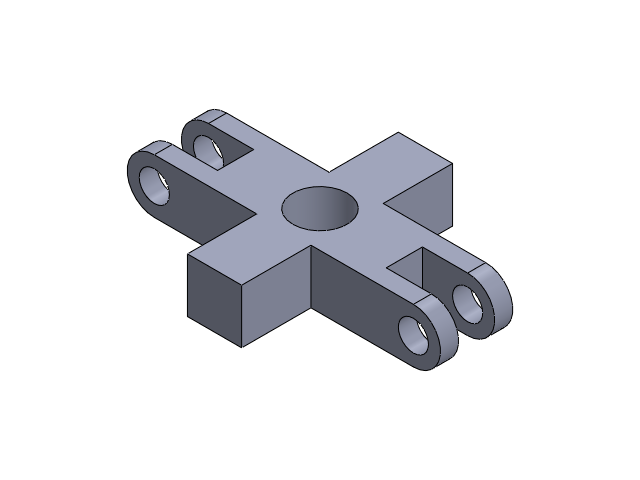 <code>CONT</code> the controller</td>
</tr>
<tr>
<td align="center">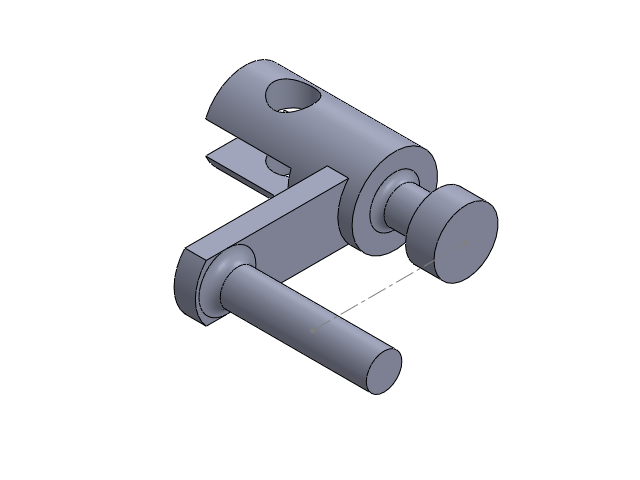 <code>coupler</code> holds a blade root</td>
<td align="center">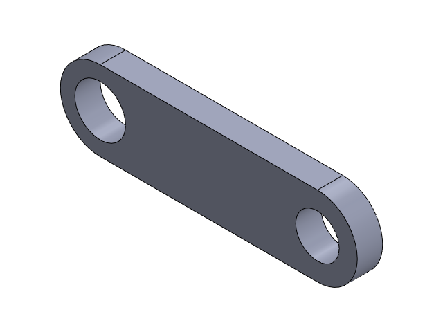 <code>string</code> the link</td>
<td align="center">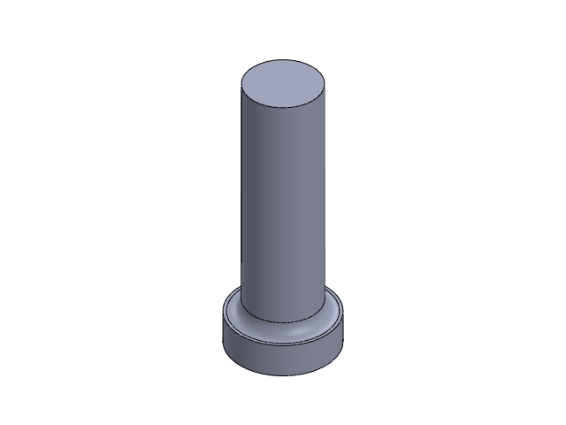 <code>bolt1</code></td>
<td align="center">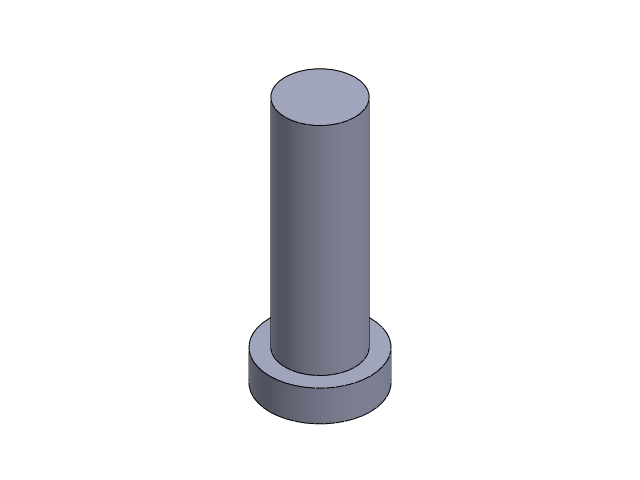 <code>bolt2</code></td>
</tr>
</table>

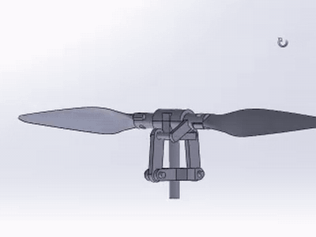 
Setting the blade angle of the two-blade assembly in SolidWorks (a screen recording,
<a href="../media/videos/03-cad-two-blade-angle-mate.mp4">full clip</a>).

The blades are our OpenProp design. `Propeller 10x45.SLDPRT` is the two-blade propeller; the assembly
uses its blade as a separate part, `10x45_wing`, which is not in this folder, so SolidWorks will report
that part as missing when it opens `Assem1.SLDASM`.

## Other files

* The sixteen blade-angle models used for the CFD are in [`cfd/models/`](../cfd/models/), next to what came
  out of them.
* The APC 12×6 model, a catalogue propeller we only tried in Flow Simulation, is not ours to share.
