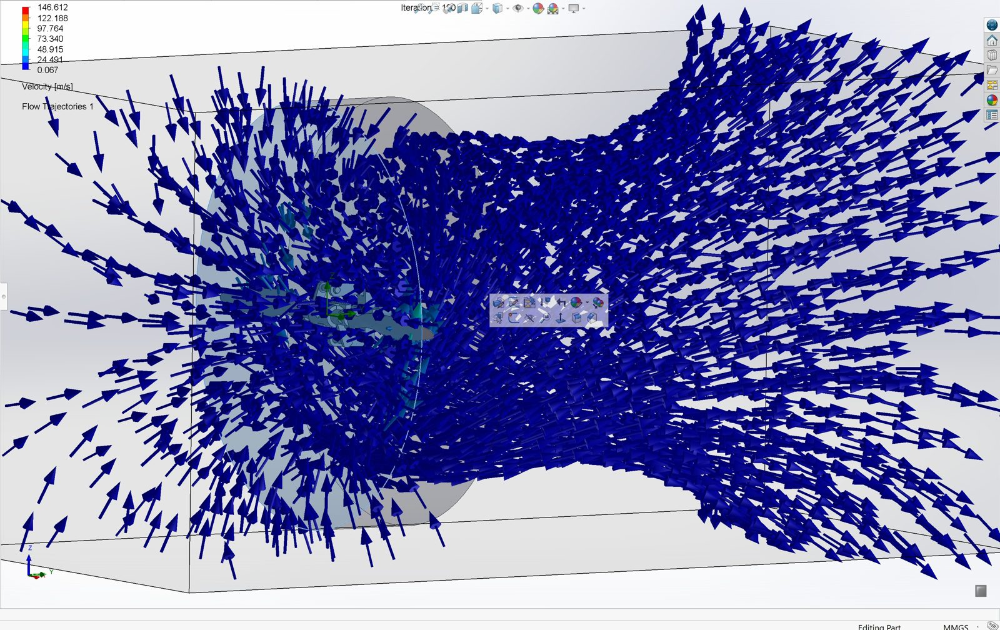
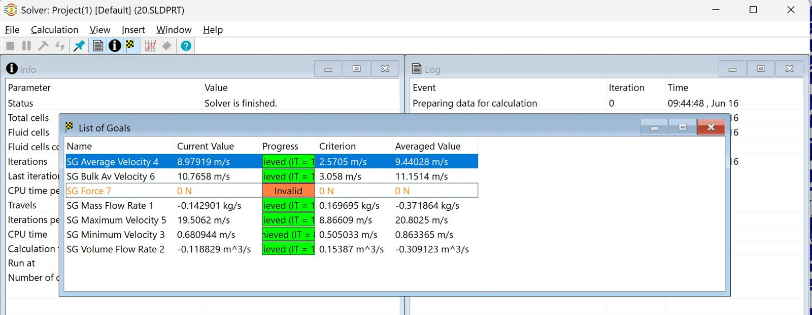
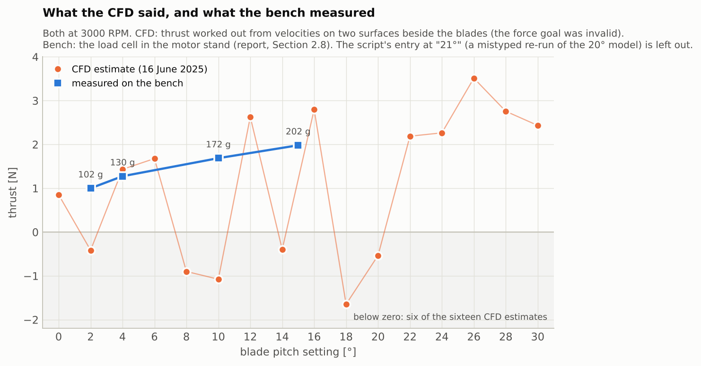
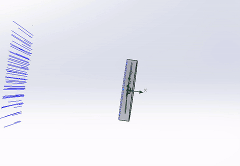
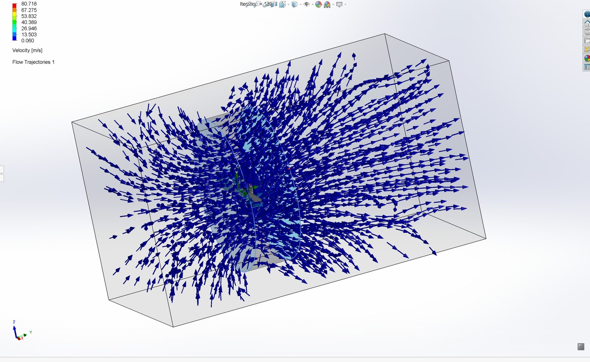
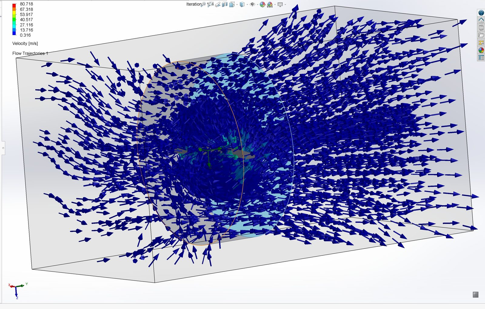
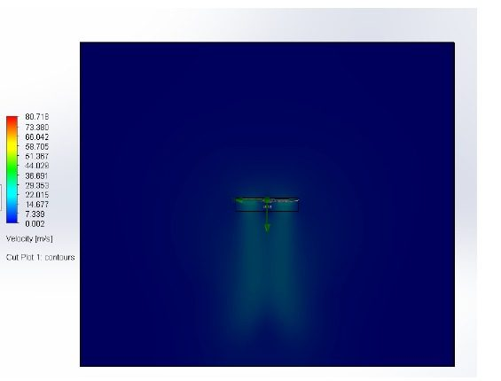

# CFD: our first try, in SolidWorks Flow Simulation

*[← back to the project](../README.md)*

This was the first time any of us had set up a CFD case. We had just been introduced to SolidWorks
Flow Simulation, and the file times tell the story of one long stretch: the propeller models went in
on the evening of 15 June 2025, the first blade-angle model was saved at 23:34, the first solver window
we kept is from 07:09 the next morning, and the thrust script was saved at 22:08 that night. The runs
were never validated: nothing was compared with an experiment, a mesh study or a published
propeller. This page keeps what we did and, now that we know better, says plainly why the numbers
jump around.

 
Flow trajectories at a pitch of 20°, 16 June 2025, inside the box-shaped computational domain.

## The setup

| | |
|---|---|
| Solver | SolidWorks Flow Simulation, external flow, air at standard sea-level conditions |
| Geometry | our two-blade hub carrying the blade of a downloaded 10×4.5 propeller model (the bodies inside the files are named `10x45_wing`), saved as one part per pitch setting (0°, 2°, … 30°) |
| Rotation | a cylindrical rotating region around the propeller at 314.16 rad/s, which is 3000 RPM ([screenshot](images/rotating-region-3000rpm.jpg)) |
| Mesh | automatic global mesh ([settings](images/global-mesh-settings.jpg)) |
| Output | surface goals: average velocity, mass flow and volume flow on two surfaces, one on each side of the blades |

We ran two rounds, both on 16 June:

* **Round 1, from 07:09 to 09:44**, with a force goal on the propeller as well, which would have
  given the thrust directly. In all eight solver windows we kept (0°, 2°, 4°, 6°, 8°, 10°, 16° and
  20°) it reads **0 N, Invalid**:

  
 
  The solver's list of goals at 20°: velocities and mass flow "achieved", the force goal invalid.

* **Round 2, from 13:55 to 14:26**, on the models named `test1_with_hub_1206_*`, with velocity and
  flow goals on an "inlet" and an "outlet" surface instead
  ([solver window at 0°](images/goals-with-hub-0deg.jpg)). That night the averaged values went into
  [`Final_graph_code.py`](Final_graph_code.py), which works out a thrust for each angle. Its numbers
  are in [`cfd_runs.csv`](cfd_runs.csv), with a note on where each one came from.

The evening before, we had also set up a downloaded APC 12×6 propeller on its own
(`test1_without_hub_1206`); we have no results from it.

## What came out

The estimates jump between −1.6 N and +3.5 N from one setting to the next, and six of the sixteen
are negative. (The script also has an entry at "21°": it is a re-run of a copy of the 20° model,
and its outlet velocity of 88.66 m/s is the inlet speed, 8.66 m/s, typed with an extra 8. It is left
out of the figure.) The four measured points rise smoothly from 1.0 N to 2.0 N. The pitch angles were
not necessarily measured from the same zero in the model and on the bench, so even the horizontal
axis is not a like-for-like comparison. In the report these scattered numbers were replaced by a
smooth table that does not come from them ([report corrections](../report/README.md)).

## Why the numbers jump, as we understand it now

1. **The force goal never worked.** A force goal on the blade surfaces is the direct way to get
   thrust (and, with a torque goal, the power). Ours returned "Invalid", and nobody stopped to fix it.
2. **The formula was right, the velocities were not.** The script uses momentum theory,
   `T = ρ A v_avg (v_out − v_in)`. That relation needs the air speed far in front of the propeller
   (zero, on a test stand) and far behind it, in the slipstream. We gave it the average velocities on
   two surfaces right next to the blades, where the inlet speed (5–10 m/s) is nearly as large as the
   outlet speed, so their difference is a small number made of two large, noisy ones.
3. **We did not even type in the same quantity every time.** Comparing the script with the solver
   windows: from 0° to 10° it has the averages of the velocity *magnitude* (which includes the
   swirl the blades add, and swirl is not thrust), at 16° and 20° the averages of the *axial* (Y)
   component; and the mass flow is the inlet's at some angles and the outlet's at others.
4. **"Achieved" did not mean converged.** Flow Simulation marks a goal achieved when its scatter falls
   below a criterion it sets itself. In the screenshots that criterion runs from about a tenth of the
   goal's own value to more than the value itself (at 20°: 2.6 m/s on an average velocity of 9.4 m/s; at 10°:
   6.9 m/s on 6.2 m/s). Each average is uncertain by about that much.
5. **The mesh was very coarse.** The one solver window that shows the cell count (10°, round 1) has
   12,759 cells in the whole domain. Thin, twisted blades need far more than that; propeller
   simulations usually run to millions.
6. **Nothing to check against.** One mesh, no refinement study, and no comparison with a measured
   propeller.

If we did it again: make the force and torque goals valid before running anything, run until the
thrust itself settles, refine the mesh until the thrust stops changing, and first reproduce a
propeller with published static test data (the
[UIUC propeller database](https://m-selig.ae.illinois.edu/props/propDB.html) has many) before
believing any trend with pitch.

## Pictures from the night

 
Flow Simulation drawing the trajectories through the propeller (a screen recording).

| | | |
|---|---|---|
|  |  |  |
| *Flow trajectories at 0°* | *at 10°* | *a velocity cut plot through the propeller* |

## Files

| | |
|---|---|
| [`Final_graph_code.py`](Final_graph_code.py) | the script as we wrote it on 16 June 2025: the averaged goal values typed in, the thrust formula, six plots |
| [`cfd_runs.csv`](cfd_runs.csv) | the same numbers as a table, with the script's thrust for each angle and, where a solver window survives, which goal each number was copied from |
| [`images/`](images/) | trajectories at 0°, 10° and 20°, a velocity cut plot, the goal lists, the rotating region and the mesh settings |

The Flow Simulation models are not here: their blades come from a downloaded propeller model that
is not ours to share. The result folders are not here either.
