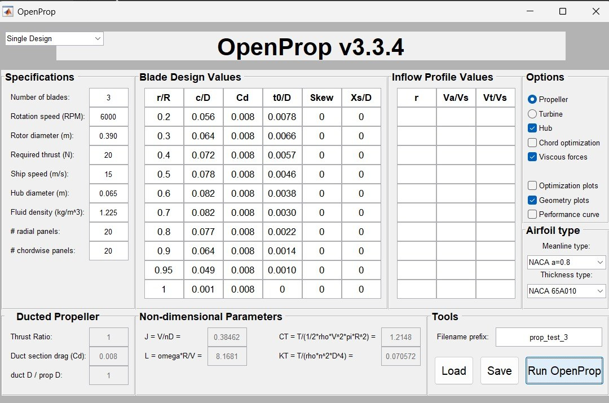
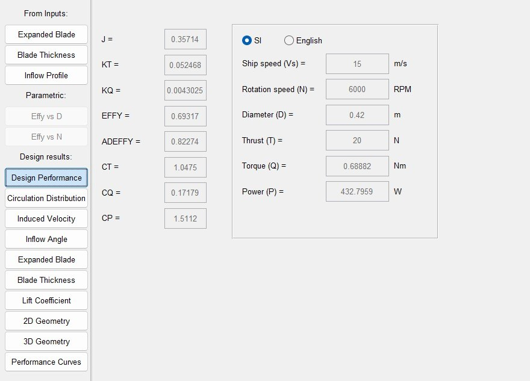
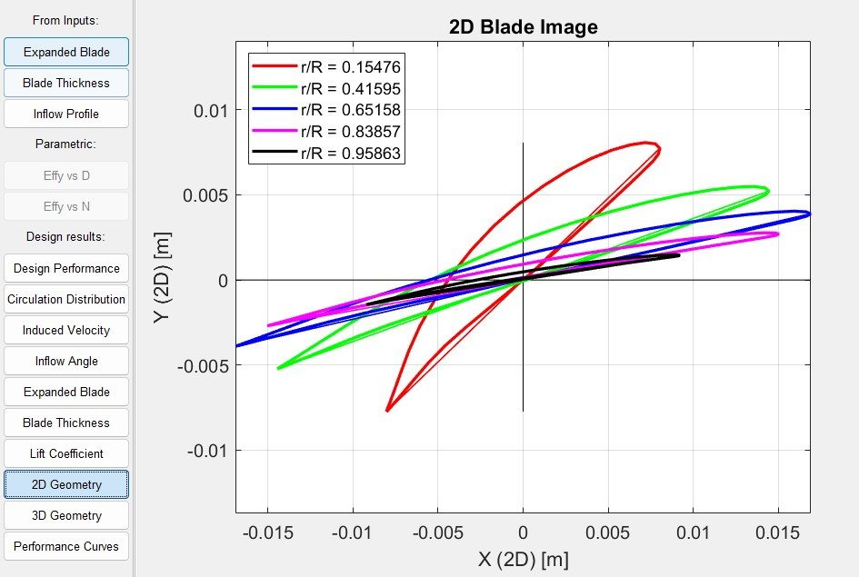
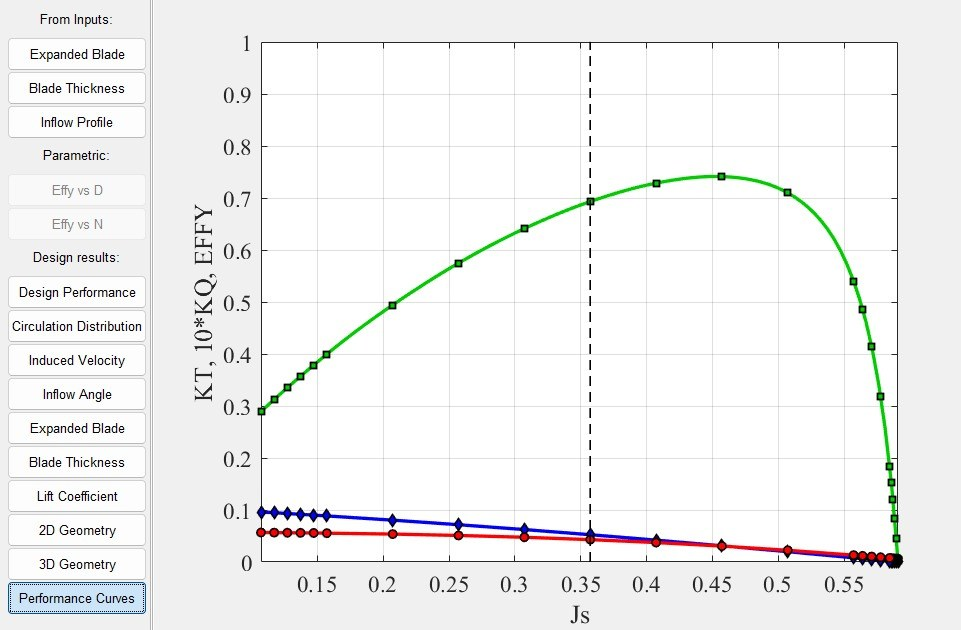
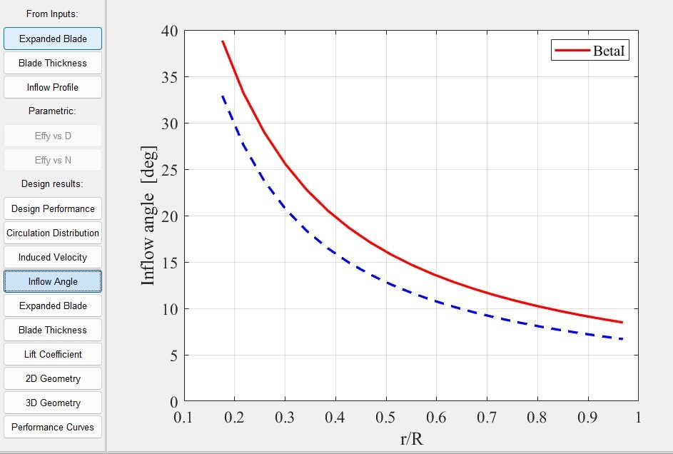
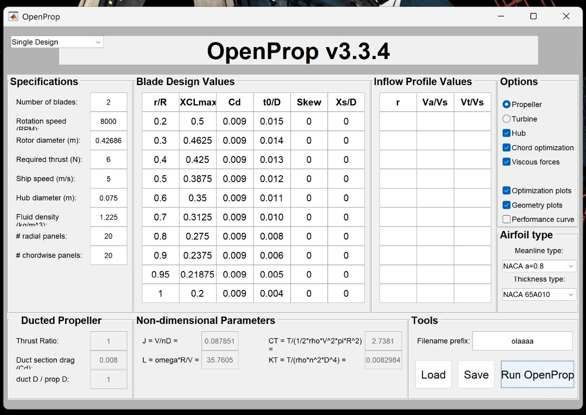
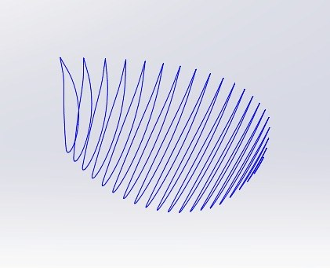

# Designing the blades in OpenProp

*[← back to the project](../README.md)*

OpenProp is a free MATLAB program for propeller design.
You give it the number of blades, the rotation speed, the diameter, the forward speed and the
thrust you want; it works out the load each section of the blade should carry, and from that the
chord, the pitch and the shape of the sections along the radius. It was the first time we had used
it, and the first time we had seen a propeller come out of an equation.

 
OpenProp v3.3.4 with the inputs of our first design.

## Two designs

| | First design | Second design |
|---|---|---|
| Blades | 3 | 2 |
| Rotation speed | 6000 RPM | 8000 RPM |
| Diameter | 0.42 m | 0.427 m |
| Hub diameter | 65 mm | 75 mm |
| Forward speed | 15 m/s | 5 m/s |
| Thrust asked for | 20 N | 6 N |
| Sections | chord given as an input (c/D from 0.056 at the root to 0.082 at mid-span), Cd 0.008 | chord from a maximum section lift coefficient (0.5 at the root to 0.2 at the tip), Cd 0.009 |
| Result | advance ratio J = 0.357, KT = 0.0525, KQ = 0.0043, efficiency 0.69, torque 0.69 N m, power 433 W | J = 0.088 and KT = 0.0083 from the inputs (we have no screenshot of the results) |

The first design became the three-blade hub of May 2025: its sections were brought into SolidWorks
as curves and lofted into a blade ([`cad/v1-three-blade/trial 1 blade.SLDPRT`](../cad/v1-three-blade/)).
When we moved to two blades at the end of May, the blade came from OpenProp too (the assembly calls it
`10x45_wing`), and the CFD used that blade.

One thing we did not see at the time: OpenProp designs a propeller for a forward speed (here 15 m/s
and 5 m/s), and its equations need one; the screen even shows L = ωR/V. Our bench measured static
thrust, with no air flowing past the propeller at all, which is exactly the condition these designs
were not made for.

## Screenshots

| | |
|---|---|
|  |  |
| *First design: the non-dimensional results and the dimensional thrust, torque and power* | *Blade sections at five radii* |
|  |  |
| *Thrust and torque coefficients and efficiency against advance ratio* | *Inflow angle along the blade, with (solid) and without (dashed) the induced velocity* |
|  |  |
| *Second design: two blades, 8000 RPM, 6 N at 5 m/s* | *The sections as curves in SolidWorks, ready to loft* |
