# Videos and photos

*[← back to the project](../README.md)*

Twenty short clips, from our phones and our screens, May to July 2025. The GIFs on this page are
silent; the clips are too, except the first-time-it-worked clip, which keeps its sound (mute it in your
player if you like). Click any picture to open its clip. GitHub offers an MP4 as a download ("View raw"), and any
video player will play it.

## The first time it worked

<table>
<tr>
<td align="center" width="50%"><a href="videos/11-first-time-it-worked.mp4">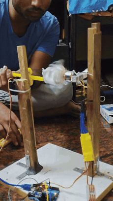</a> 
The propeller spinning and its blades changing pitch at the same time, for the first time, and the faces
that went with it. <a href="videos/11-first-time-it-worked.mp4">Full clip, with sound, 58 s</a></td>
<td align="center" width="50%"><a href="videos/12-at-the-bench.mp4">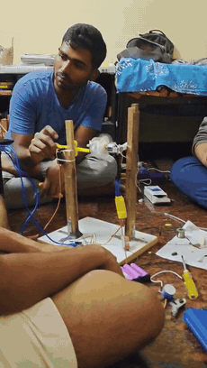</a> 
At the bench, working on it while it runs. <a href="videos/12-at-the-bench.mp4">Full clip, 28 s</a></td>
</tr>
</table>

## In SolidWorks

<table>
<tr>
<td align="center" width="50%"><a href="videos/01-cad-three-blade-pitch.mp4">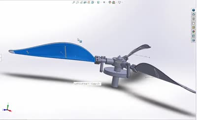</a> 
25 May 2025: the three-blade hub, with the blade lofted from OpenProp, swinging through its pitch range. 19 s</td>
<td align="center" width="50%"><a href="videos/02-cad-three-blade-angle-mate.mp4">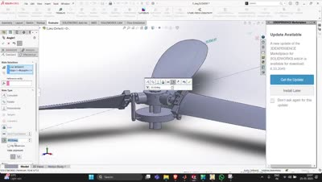</a> 
25 May 2025, 20:07: setting the blade angle in the three-blade assembly. 35 s</td>
</tr>
<tr>
<td align="center"><a href="videos/03-cad-two-blade-angle-mate.mp4">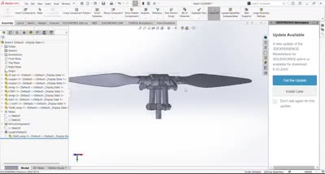</a> 
The two-blade assembly, setting its blade angle. 33 s</td>
<td align="center"><a href="videos/04-cfd-flow-trajectories.mp4">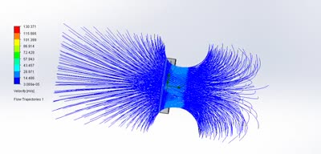</a> 
Flow Simulation drawing the flow through the propeller. 6 s</td>
</tr>
</table>

## The electronics

<table>
<tr>
<td align="center" width="50%"><a href="videos/05-first-motor-test.mp4">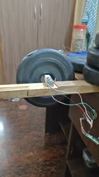</a> 
A motor test on a plank, with the code on the laptop. 5 s</td>
<td align="center" width="50%"><a href="videos/06-bench-and-serial-monitor.mp4">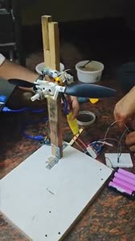</a> 
The bench, and then the readings scrolling on the serial monitor. 47 s</td>
</tr>
</table>

## The servo turning the blades

<table>
<tr>
<td align="center" width="50%"><a href="videos/07-servo-pitch-change-1.mp4">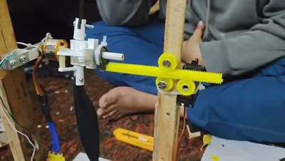</a> 
The servo slides the rack and the blades turn. 22 s</td>
<td align="center" width="50%"><a href="videos/08-servo-pitch-change-2.mp4">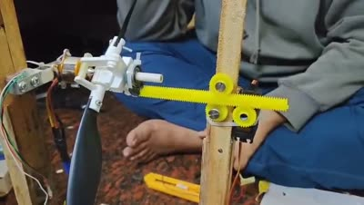</a> 
Again, ending with a push on the rack by hand. 16 s</td>
</tr>
<tr>
<td align="center"><a href="videos/10-servo-pitch-change-4.mp4">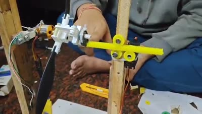</a> 
A longer run of the same. 24 s</td>
<td align="center"><a href="videos/09-servo-pitch-change-3.mp4">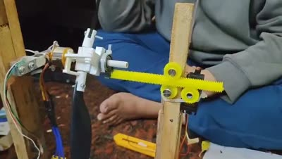</a> 
One second of it. 1 s</td>
</tr>
</table>

## Runs on the bench

<table>
<tr>
<td align="center" width="25%"><a href="videos/13-setting-the-blades.mp4">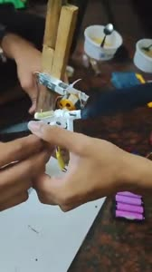</a> 
Setting the blades by hand. 9 s</td>
<td align="center" width="25%"><a href="videos/14-spinning-close-up.mp4">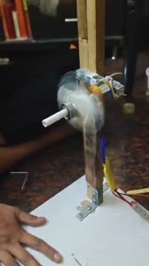</a> 
Close up, spinning. 4 s</td>
<td align="center" width="25%"><a href="videos/15-bench-run-1.mp4">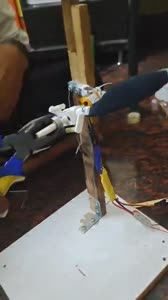</a> 
A run. 22 s</td>
<td align="center" width="25%"><a href="videos/16-bench-run-2.mp4">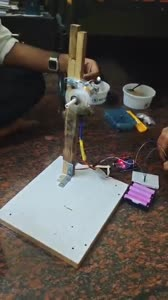</a> 
A run. 15 s</td>
</tr>
<tr>
<td align="center"><a href="videos/17-bench-run-3.mp4">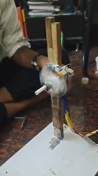</a> 
A run. 8 s</td>
<td align="center"><a href="videos/18-bench-run-4.mp4">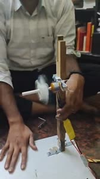</a> 
A run. 12 s</td>
<td align="center"><a href="videos/19-bench-run-5.mp4">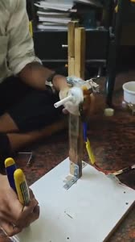</a> 
A run. 7 s</td>
<td align="center"><a href="videos/20-bench-run-6.mp4">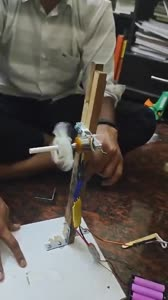</a> 
A run. 21 s</td>
</tr>
</table>

## Photos

<table>
<tr>
<td align="center" width="33%">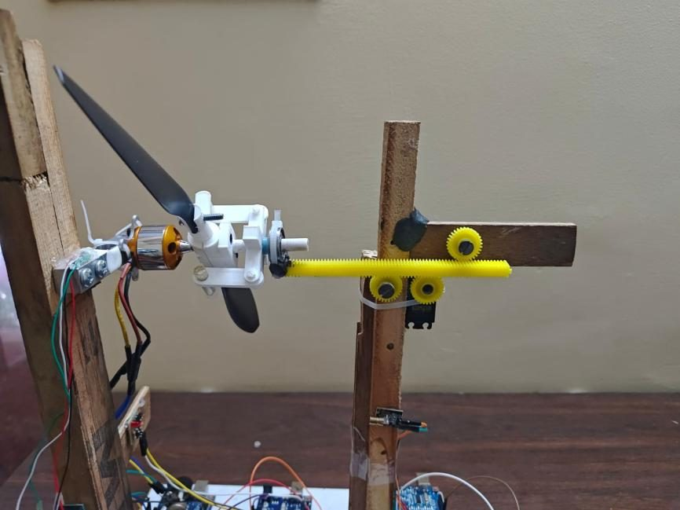 The bench from the side: the hub, the rack and the servo</td>
<td align="center" width="33%">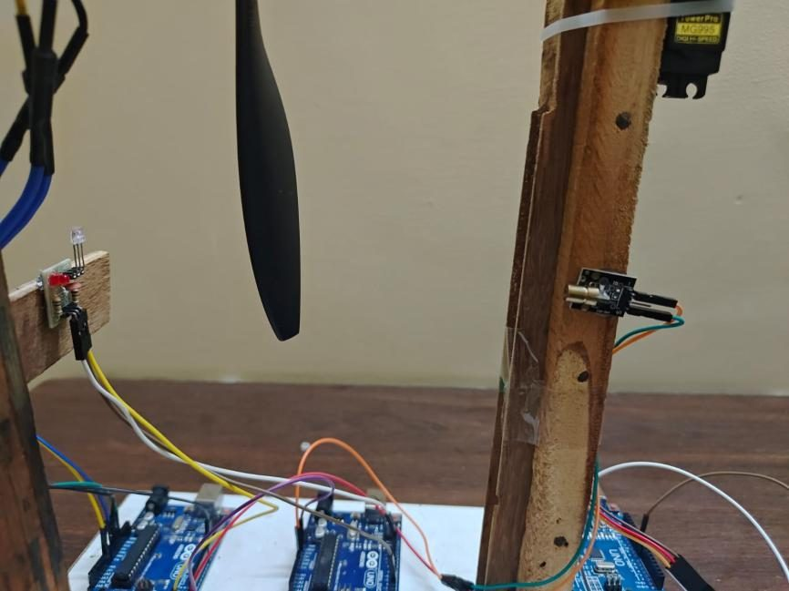 The laser tachometer across the blade path</td>
<td align="center" width="33%">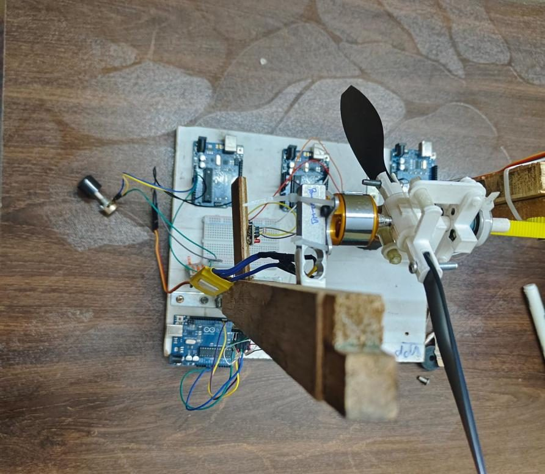 From above: the Arduinos on the board</td>
</tr>
<tr>
<td align="center">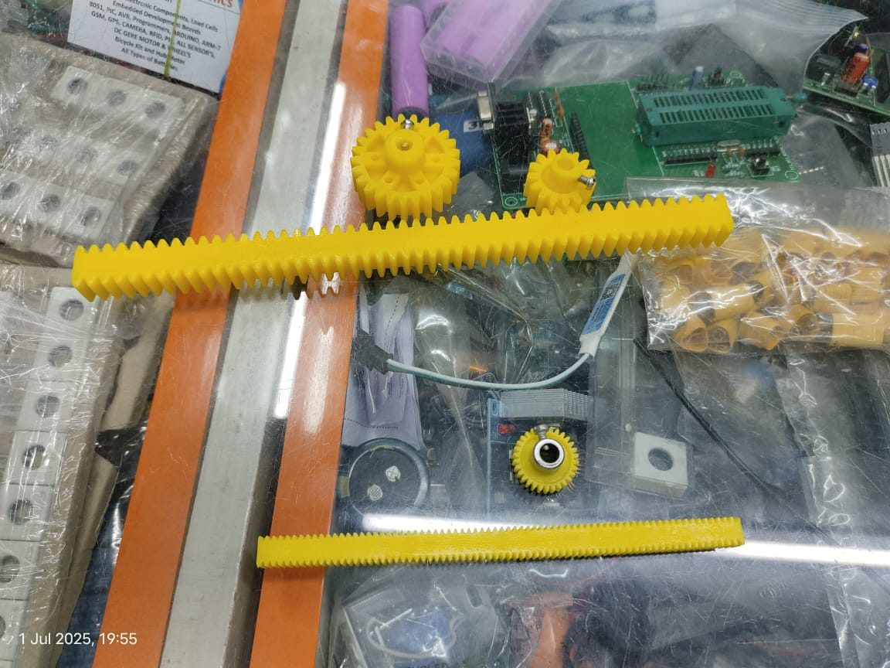 1 July 2025: racks and pinions on a shop counter</td>
<td align="center">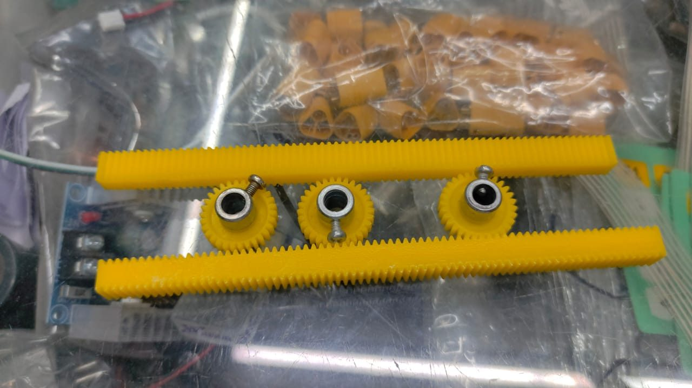 Two racks and three pinions</td>
<td align="center">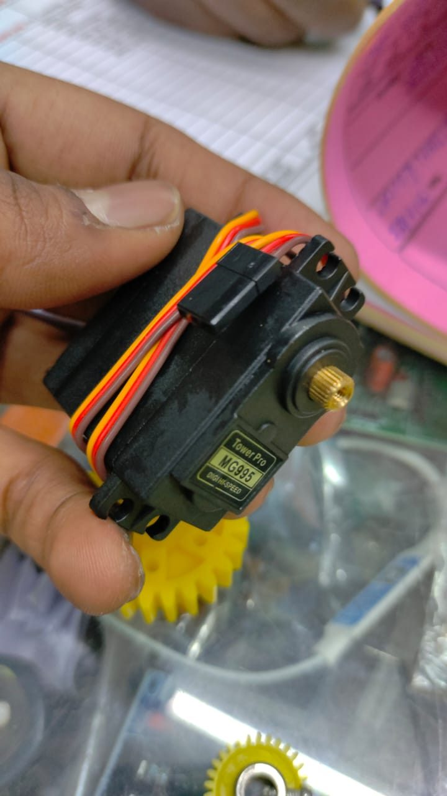 The servo</td>
</tr>
<tr>
<td align="center">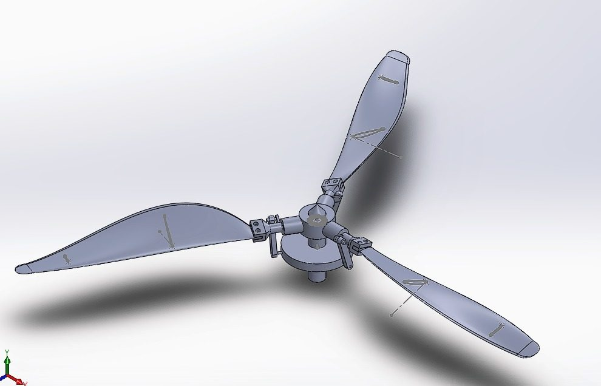 The three-blade propeller in SolidWorks</td>
<td align="center">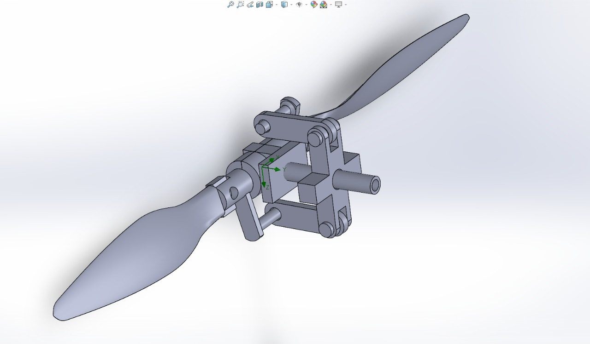 The two-blade hub in SolidWorks</td>
<td align="center">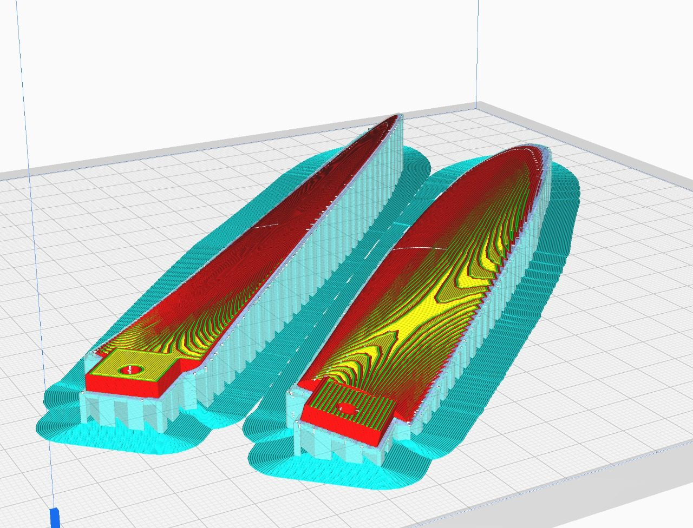 The blades in Cura</td>
</tr>
</table>
