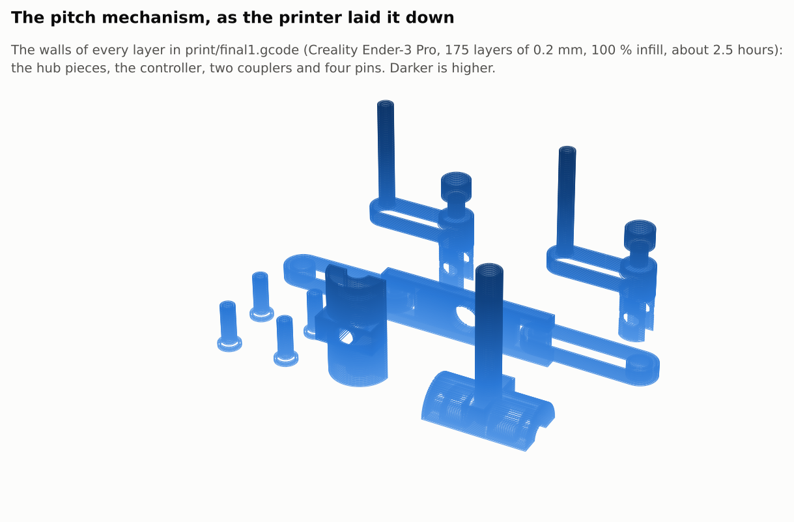

# The printed parts

*[← back to the project](../README.md)*

Two plates of G-code, sliced in Ultimaker Cura 5.10 for a Creality Ender-3 Pro (Marlin): 0.2 mm
layers, 100 % infill in a triangle pattern, supports on, 40 mm/s. The names in the table are the
part names Cura recorded inside each file.

| File | Parts | Print time | Filament |
|---|---|---|---|
| [`final1.gcode`](final1.gcode) | `hub`, `hub1`, `p1`, two `p2`, four `bolts` | 2 h 31 min | 3.42 m |
| [`WING_excluding.gcode`](WING_excluding.gcode) | `hub`, `hub1`, two `coupler`, `printable` | 2 h 7 min | 2.99 m |

Both are 35 mm tall, 175 layers. "WING excluding" means what it says: everything but the blades,
which were printed on their own.

The picture is drawn straight from the walls of every layer in `final1.gcode` by
[`tools/make_figures.py`](../tools/make_figures.py).
